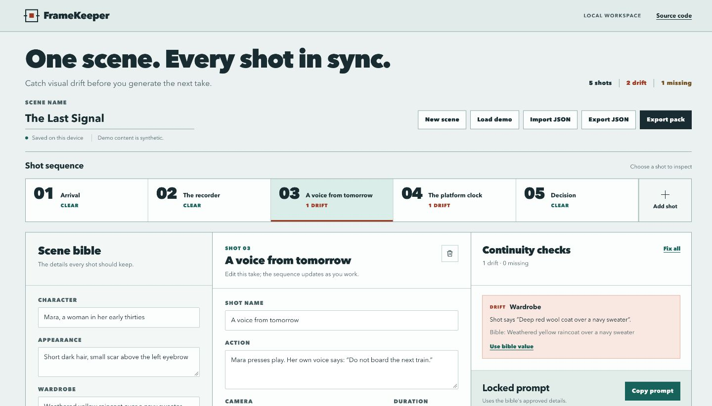

# FrameKeeper

Keep a multi-shot AI video scene visually consistent before you generate the next take.

FrameKeeper is a small, local-first continuity workspace. Define the character, wardrobe, prop, location, and lighting once in a scene bible. Enter each shot. The app flags mismatched or missing details, explains what the bible expects, and builds a prompt with the approved anchors. It runs without an account, model API, or build dependencies.

> The included scene, *The Last Signal*, is synthetic demonstration content. FrameKeeper checks explicit structured fields; it does not analyze video frames or infer facts from free-form scripts.



## The 60-second demo

1. Run the app and open [http://127.0.0.1:4173](http://127.0.0.1:4173).
2. Select shot 03. Its red coat differs from the yellow raincoat in the bible. Select **Use bible value** and watch the sequence status change.
3. Select shot 04. Fix its lighting and missing prop.
4. Select **Copy prompt** for a model-ready shot description, then **Export pack** for a Markdown continuity record.

The demo begins on shot 03 so the cause and correction are visible immediately.

## Run locally

Requires Node.js 18 or newer. There are no npm dependencies.

```bash
git clone https://github.com/maomao-1937/framekeeper-ai-continuity.git
cd framekeeper-ai-continuity
npm start
```

Open `http://127.0.0.1:4173`. The server binds to localhost. To use another port, set `PORT=5000 npm start` on macOS/Linux or `$env:PORT=5000; npm start` in PowerShell.

```bash
npm test       # five behavior tests for drift, missing values, import and export
npm run check  # JavaScript syntax checks
npm run build  # copy the dependency-free static app to dist/
```

## Workflow

- Edit the scene bible. Each non-empty anchor becomes a continuity rule.
- Add shots and describe visible action, camera movement, duration, and scene anchors.
- The shot strip displays drift, missing details, or a clear state. Each issue shows the actual and expected values.
- Fix one field or all issues in the selected shot. A locked prompt uses the bible's approved values even before the issue is repaired.
- Export JSON to back up or share editable work. Import the same format later. Export Markdown for a readable pack with checks and per-shot prompts.
- Work is saved in this browser's local storage. The app sends no project data to a server.

## Project layout

| File | Purpose |
| --- | --- |
| `core.js` | Pure continuity rules, import validation, prompt and Markdown export |
| `sample.js` | Synthetic five-shot demo scene |
| `app.js` | Browser interface, editing, autosave, import and export |
| `styles.css` | Responsive workspace design |
| `tests/core.test.js` | Behavior tests using Node's built-in test runner |
| `server.mjs` | Small localhost server for ES modules |

## Boundaries

- A project represents one scene with a fixed bible. A deliberate costume, place, or light change should start a new scene or update the bible.
- Matching ignores capitalization and repeated whitespace, but otherwise uses explicit text comparison. It cannot judge whether two descriptions are visually equivalent.
- The app does not generate media, inspect frames, call an LLM, or promise consistent model output.
- Browser storage can be cleared by the user or the browser. Export JSON to keep an independent copy.

## Next steps

1. Add intentional per-shot overrides with visible reasons.
2. Add optional image-reference comparison that runs locally.
3. Add a shareable, read-only scene pack without uploading private projects by default.

## License

MIT. See [LICENSE](LICENSE).
